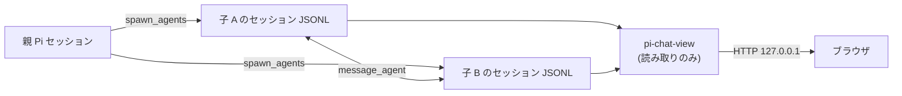

# pi-chat-view

pi-spawn で起動した子エージェント同士のやり取りは、子ごとの JSONL ファイルに分かれて保存されます。そのため、会話全体の流れを追いにくいです。pi-chat-view は、同じ spawn 呼び出しの子同士の会話を1本の時系列としてブラウザに表示します。

子セッションの JSONL を読むだけで、書き込みは行いません。`/chat-view` でループバック（`127.0.0.1`）に読み取り専用のサーバーを起動し、表示された URL をブラウザで開きます。



## 使い方

Pi で `/chat-view` を実行し、通知された URL（既定は `http://127.0.0.1:7787`）をブラウザで開きます。

ページは2つの領域に分かれます。

- 左: スレッド一覧。各スレッドに開始時刻・最終更新時刻と参加者名を表示します。
  - ● は最終更新から90秒以内のスレッドに付きます。
  - ⚠ は兄弟一覧を解釈できなかったスレッドに付きます。
- 右: 選んだスレッドのタイムライン。

表示される内容は次のとおりです。

| 種類 | 元になる記録 | 表示 |
|---|---|---|
| 発言 | `message_agent` の呼び出し | 常に表示。宛先があれば `→ 名前` を添える |
| 描写・回答 | assistant の text | 常に表示 |
| 指示 | 子に届いたタスク（配送の複製を除く） | 折りたたんで表示 |
| reasoning | thinking ブロック | 非表示。`reasoning` トグルで表示 |
| ツール呼び出し | `message_agent` 以外の tool call | 非表示。`tools` トグルで表示。名前と引数の要約だけ |

- 指示には、最初のタスクと再開時のタスクの両方が含まれます。
- 子に送られた兄弟一覧（タスク先頭の宛先リスト）は、指示から取り除いて表示します。
- 種類が分からないエントリは表示しません。
- 発言は発言者ごとに色分けし、時刻・発言者・宛先を1行にまとめます。
- 2分を超える間隔は「— 3分後 —」のような区切りで示します。
- 開いているスレッドは URL の `#` に入ります（例: `#47aac6be+f83c6332`）。`reasoning` と `tools` のトグル状態は URL の `?reasoning=1&tools=1` に入ります。
- 開いたスレッドが見つからなくなった場合は、一覧の先頭（最新）のスレッドに切り替えます。
- 更新は1.5秒ごとに取得します。タブが非表示の間は取得を止めます。
- スレッド一覧の ● と経過時間の表示は、7.5秒ごとに描き直されます。

## インストール

### 前提条件

| 項目 | 条件 |
|---|---|
| Pi | 開発・検証は 0.87.1 で行っています |
| Node.js | 22.19.0 以上 |
| 子セッション | pi-spawn が `<agentDir>/spawn-sessions/` に子の JSONL を書いていること |
| pi-spawn | 実行時には不要です。読むのは JSONL の配置と形式だけです |

`agentDir` の既定は `~/.pi/agent` です。`PI_CODING_AGENT_DIR` で変更できます。

### インストール方法

```bash
pi install git:github.com/kurowashi/pi-chat-view
```

ref を固定する場合は `pi install git:github.com/kurowashi/pi-chat-view@<tag|commit>` を使います。

ローカルの作業コピーを使う場合は次のとおりです。

```bash
pi install /path/to/pi-chat-view
```

インストールせずに読み込む場合は次のとおりです。

```bash
pi --extension /path/to/pi-chat-view/src/index.ts
```

## 設定

設定ファイルは `<agentDir>/chat-view.json` です。

```json
{
	"port": 7787
}
```

| キー | 既定 | 意味 |
|---|---|---|
| `port` | `7787` | 待ち受けポート（1〜65535 の整数） |

- ファイルがない場合は、既定のポートで動きます。
- 値が不正な場合（JSON が壊れている、`port` が整数でない、または範囲外）は、既定のポートで動き、`/chat-view` の起動時と停止中の `/chat-view status` で警告します。
- 設定は `/chat-view` を実行するたびに読みます。起動中のサーバーは、起動時のポートのままです。
- ポートが使用中の場合は起動せず、`port <番号> is already in use; set another port in chat-view.json` を通知します。
- 待ち受けアドレスは `127.0.0.1` に固定されており、変更できません。

## 仕組み

### スレッドの決まり方

子は、同じ spawn 呼び出しの兄弟を、タスク先頭の兄弟一覧で参照します。その参照で結ばれた子の集まりを1つのスレッドにします。

| 規則 | 内容 |
|---|---|
| 参加者 | 兄弟一覧で互いに参照し合う子 |
| 継続 | `resume_session_id` と `resume_entry_id` で再開した子は、同じファイルに追記されるため同じスレッドに残る |
| 識別子 | 参加する子のセッション id を昇順に `+` で連結したもの。URL の `#` に使う |
| 単独 | 兄弟のいない子は、1ファイルだけのスレッドになる |

- 参照先のファイルが見つからない id は無視します（再開前の run id など）。
- 兄弟一覧は、現在の形式（`target_session_id= name= agent=`）と、旧形式（`name (id)`、`target_run_id=`）を読みます。
- 兄弟一覧を読めない子があると、そのスレッドに警告を表示します。pi-spawn の形式が変わった可能性があるためです。

### 重複と分岐

- 発言は時刻順に並べます。同じ時刻の場合は子のファイル順です。
- 子に届いたメッセージは受け手の指示にも残ります。送信側に同じ本文の `message_agent` 呼び出しがあり、同じスレッド内にある場合に限り、受け手側の複製を除きます。送信側の記録がない場合は、受け手側を指示として表示します。
- `resume_entry_id` で過去の位置から再開すると、ファイルに破棄された分岐が残ります。表示するのは、最後の発言から親をたどった分岐だけです。分岐を読み取れない古い形式のファイルは、書かれた順にすべて表示します。
- `inheritConversation` の子は、親から引き継いだ履歴を子の会話として表示しません。ただし、親のセッションファイルが残っている場合に限ります。親のファイルが見つからない場合は、引き継いだ履歴も含めて表示します。

## コマンド

| コマンド | 動作 |
|---|---|
| `/chat-view` | サーバーを起動し、URL を通知する |
| `/chat-view start` | `/chat-view` と同じ |
| `/chat-view stop` | サーバーを停止する |
| `/chat-view status` | 稼働状態、使用ポート、設定ファイルのパスを表示する |

- 起動中に `/chat-view` を実行すると、URL を再表示します。
- 起動の途中に `/chat-view` を実行すると、起動中であることを通知します。
- 起動していないときに `/chat-view stop` を実行すると、その旨を通知します。
- Pi を終了すると、サーバーは自動で停止します。再び使うには `/chat-view` を実行します。
- 不明な引数は使い方を通知します。

## 制限

| 制限 | 対処 |
|---|---|
| 同じ端末からしか開けない（`127.0.0.1` 固定） | 別の端末から見るには SSH ポート転送を使う |
| 認証がない。同じ端末の他のユーザーからも読める | 共有の端末では使わない |
| 読み取り専用。書き込みや再開はできない | 子のセッションは `pi --session <path>` で開く |
| 親セッションの発言は表示しない | 親のセッションは `pi --session <path>` で開く |
| 実行中と完了を区別しない | 最終更新時刻と ● で判断する |
| run id からスレッドを引けない | スレッド一覧から選ぶ |
| 新しい発言は最大1.5秒遅れて現れる | 対処なし |
| スレッド一覧は新しい順に100件まで | 古いスレッドは URL の `#<識別子>` で直接開く |
| ブラウザを自動で開かない | 通知された URL を開く |

- 子の数が増えると、一覧を更新するたびに、すべての子のファイルの先頭と末尾を読みます。
